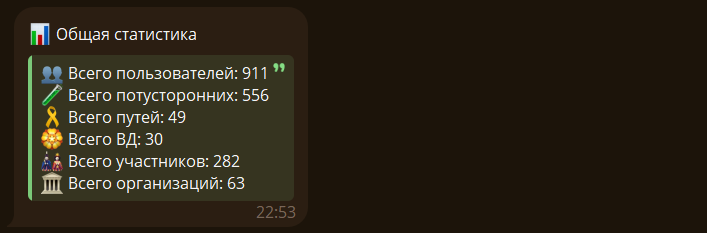
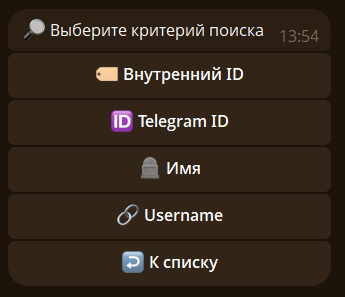
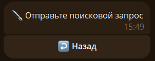
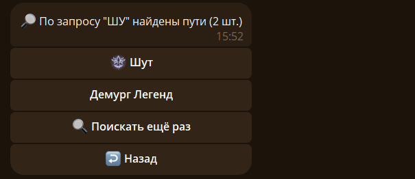
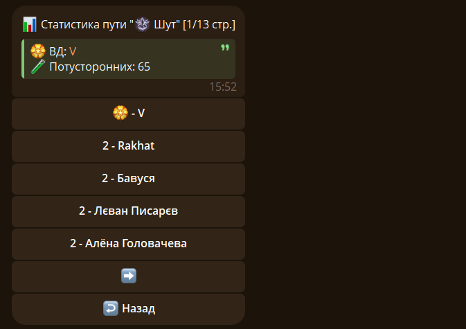
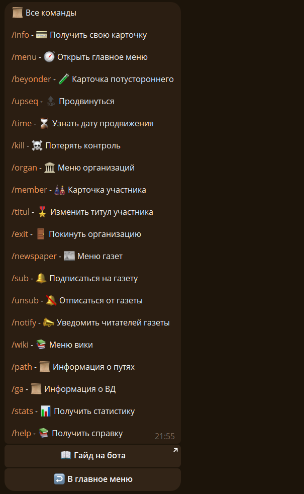
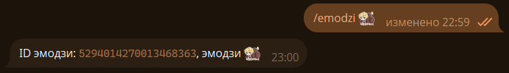
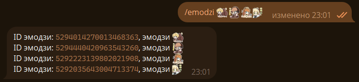

## 🧭 Открыть Главное меню {#menu}

Чтобы получить меню бота используйте команду `/menu`:

## 📊 Получить общую статистику {#stats}

Чтобы получить статистику бота используйте команду `/stats`:

## 👤 Получить карточку аккаунта {#user}

Чтобы открыть карточку своего аккаунта используйте команду `/user`. Чтобы посмотреть по внутреннему ID, укажите его после команды: `/user {user_id}`.

## 👥 Просмотреть список пользователей {#users}

Команда `/users` открывает список пользователей. В списке можно переходить между страницами и искать пользователя по внутреннему ID, Telegram ID, username или имени.

## 🗑️ Запросить удаление аккаунта {#deleteuser}

Чтобы запросить удаление своего аккаунта используйте команду `/deleteuser`. Перед удалением бот попросит подтвердить действие. Нажмите `✅ Да, удалить` для подтверждения или `❌ Нет, отмена`, чтобы отменить запрос.

## 🧪 Получить статистику пути {#stats-paths}

Чтобы получить статистику пути используйте команду `/stats` и нажмите на кнопку `🔍 Статистика путей`:

Вводим название пути: 

Выбираем нужный путь
<!--stats-path-start-->

<!--stats-path-end-->
Если нажать на одного из потусторонних, получим его карточку:



## 📚 Получить справку {#help}

Чтобы получить краткую справку используйте команду `/help`:

## 😀 Получить ID кастомного эмодзи {#emodzi}

Чтобы получить ID кастомного эмодзи используйте команду `/emodzi`, вписав после команды нужный эмодзи:

Можно несколько:

