## 🎴 Получить карточку {#info}

Чтобы получить полную карточку используйте команду `/info`:

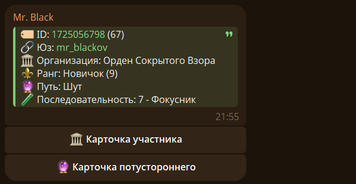

>❗Если хотите карточку другого пользователя используйте `/info`, ответив на его сообщение. Получите уже его карточку.

Можно получить карточку потустороннего.

Для этого используйте команду `/beyonder`:

<!--beyonder-info-start-->

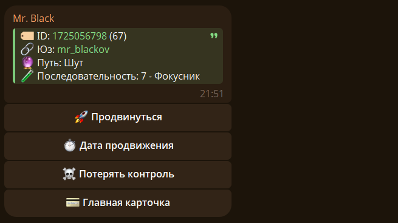

<!--beyonder-info-end-->

## 🧪 Выпить зелье {#drink}

<!--drink-start-->

Чтобы стать потустронним используйте команду `/path`:

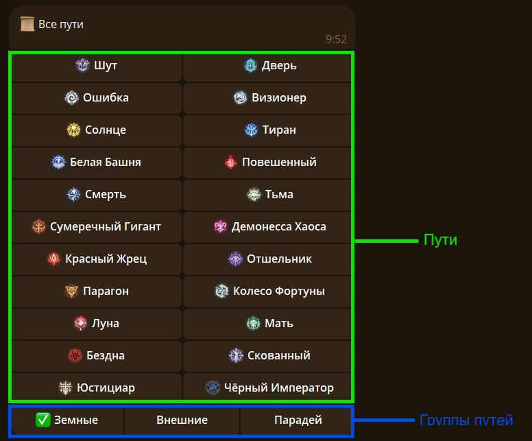

Выбираем путь и нажимаем на кнопку с названием пути:

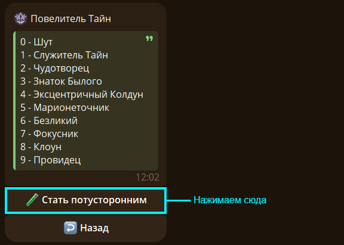

После нажатия кнопки получаем примерно такое сообщение: 

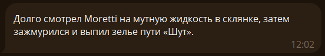

<!--drink-end-->

Можно стать и через `/drink`:

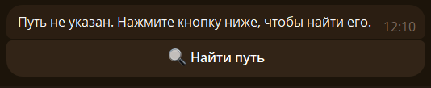

Нажимаем на кнопку 

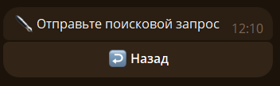

Отправляем боту название пути или последовательности: 

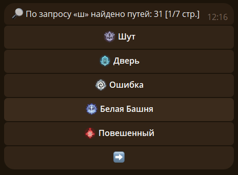

Выбираем путь и нажимаем на кнопку с названием пути:

После нажатия кнопки получаем примерно такое сообщение: 

Поздравляю, вы стали потусторонним 9 последовательности.

## 🔝 Продвинуться {#upseq}

Чтобы перейти на следущюю последовательность, нужно переваривать зелье. 

Проверить сколько дней осталось можно с помощью команды `/upseq`:

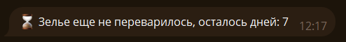

Или `/time`, если хотите увидеть полную информацию: 

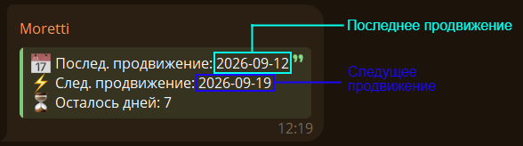

Как только настанет дата продвижения можно использовать `/upseq`, чтобы перейти на следущюю последовательность и выбрать путь для перехода:

Нажимаем на `✅ Продвинуться`:

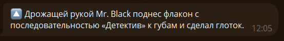

>❗Если хотите узнать дату продвижения другого пользователя используйте `/time`, ответив на его сообщение.

## ☠️ Потерять контроль {#kill}

Чтобы потерять контроль используйте команду `/kill`:

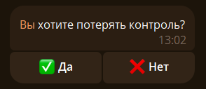

Нажав на кнопку `Да` вы потеряете контроль и перестанете быть потусторонним. 

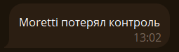

Теперь вы можете выбрать другой путь и снова пойти по пути Потусторонних