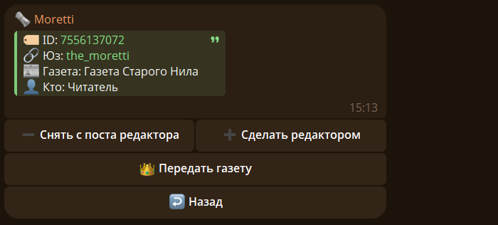
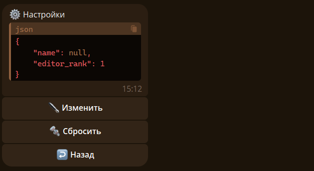
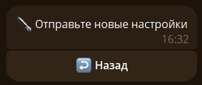
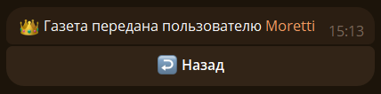

## 👥 Управление редакторами {#manage}

Чтобы назначить или снять редактора, откройте список читателей газеты и выберите пользователя:

- `/newspaper make <id_газеты> <id_пользователя>` — назначить редактора;
- `/newspaper fire <id_газеты> <id_пользователя>` — снять с поста редактора.

Также можно ответить на сообщение пользователя командами `/make <id_газеты>` или `/fire <id_газеты>`. Доступные действия зависят от ваших прав.

Либо использовать кнопки в карточке читателя.



## ⚙️ Настройки {#settings}

Откройте карточку газеты и нажмите `⚙️ Настройки` или отправьте `/newspaper settings <id_газеты>`. Чтобы изменить настройки, отправьте новый JSON; кнопка `🔩 Сбросить` возвращает настройки по умолчанию.



??? note "JSON-вид настроек"

    ```json
    {
        "name": null,
        "emodzi": null,
        "custom_emodzi_id": null,
        "description": null,
        "start_rank": 2,
        "editor_rank": 1
    }
    ```

### 🔧 Редактирование {#setting_redact}

Чтобы редактировать настройки нажмите на кнопку `✒️ Изменить`:



Чтобы изменить параметры, важно отправлять параметры в виде словаря (из Python):

1. Названия и значения параметров важно заключять внутри фигурных скобок.

2. Названия должно быть строго такими же как в настройках и внутри кавычек.

3. После названия параметра должно стоять двоеточие, и потом его значение.

4. Вид значения зависит от параметра. Может быть числом, строкой, булевым значением или словарем.

5. Если параметров для изменения несколько перечисляйте их через запятую.

6. Порядок параметров не важен.

Пример сообщения для изменения настроек:

```json
{
    "start_rank": 1,
    "editor_rank":1
}

```

>❗ Булевое значение - это значение, которое может быть либо false, либо true.

### 🔩 Все Параметры {#setting_all_paremetrs}

##### 🔖 Название {#setting_paremetr_name}

Чтобы изменить название организации используйте этот шаблон:

```json
{"name":"новое название"}
```

##### 😀 Эмодзи {#setting_paremetr_emodzi}

Чтобы изменить эмодзи используйте этот шаблон:

```json
{"emodzi":"новое эмодзи"}
```

>❗Кастомные эмодзи - эмодзи создаваемые пользователями и доступные для использования только по Telegram-премиуму.

Чтобы изменить кастомное эмодзи используйте этот шаблон:

```json
{"custom_emodzi_id":"ID кастомного эмодзи"}
```

Узнать ID кастомного эмодзи можно через команду `/emodzi`.

>❗Если вы указали и обычное эмодзи и кастомное, то всем будет показывать кастомное.

##### 📜 Описание {#setting_paremetr_description}

Чтобы изменить описание используйте этот шаблон:

```json
{"description":"новое описание"}
```

##### 🏁 Начальный ранг {#setting_paremetr_start_rank}

При входе в организацию дается ранг указанный в этом параметре. По умолчанию Читатель.

> ❗Важно:
>    - Читатель - ранг 2
>    - Редактор - ранг 1
>    - Автор - ранг 0

Чтобы изменить начальный ранг используйте этот шаблон:

```json
{"start_rank":ранг}
```

> ❗Важно указывать числовое представление ранга.

##### ✒️ Ранг Редатора {#setting_paremetr_editor_rank}

Чтобы изменить ранг для использования команды /notify используйте этот шаблон:

```json
{"editor_rank":ранг}
```

## 👑 Передача газеты {#give}

В списке читателей выберите пользователя и нажмите `👑 Передать газету`, затем подтвердите действие.


