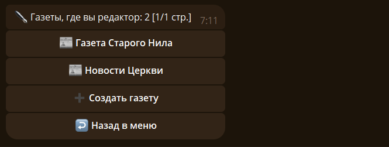
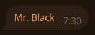
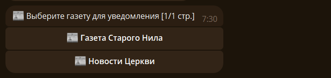

# ✒️ Редакторы

Команда `/newspaper editors` показывает газеты, в которых вы редактор. Откройте карточку своей газеты, чтобы выпустить новость, посмотреть читателей или открыть настройки.

## 📣 Публикация новости {#notify}

Ответьте на сообщение, которое должны увидеть читателям, командой `/notify <id_газеты>`. Также можно открыть карточку газеты и нажать `📣 Выпустить новость`.

> ❗Это ссылка отмечает пользователя.

Если вы не указали айди газеты, то появится меню выбора газеты.

