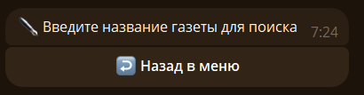
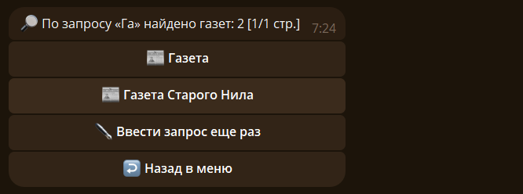
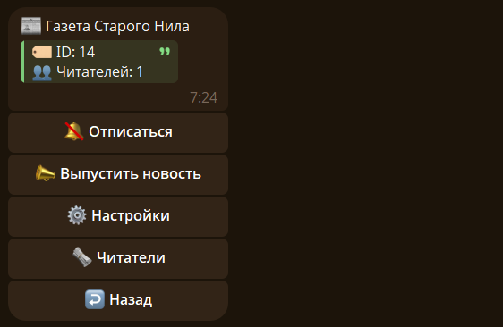
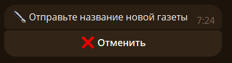

# 📰 Газеты

Откройте меню газет командой `/newspaper`. В меню доступны раздел редактора, раздел читателя, поиск и список всех газет.

## 🔎 Поиск газеты {#search}

Выберите `🔎 Найти газету` в меню или отправьте `/newspaper search`. Введите название или его часть, затем выберите нужную газету в результатах.

Выберите подходящую газету в списке результатов:

## 📜 Список газет {#list}

- `/newspaper all` — показать все газеты.
- `/newspaper list` — показать список газет, на которые вы подписаны.
- `/newspaper editors` — показать газеты, в которых вы редактор.

Чтобы открыть карточку газеты, выберите её в списке или отправьте `/newspaper info <id>`.

В карточке доступны сведения о газете и список читателей. 

Подписаться или отписаться можно кнопкой в карточке, либо командами `/newspaper subscribe [id]` и `/newspaper unsubscribe [id]`. Без ID бот предложит выбрать газету.

## ➕ Создание газеты {#create}

Отправьте `/newspaper create <название>`. Если название не указано, бот попросит отправить его отдельным сообщением.

После создания откройте карточку газеты и используйте меню редактора, чтобы управлять газетой.
