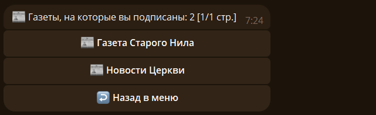
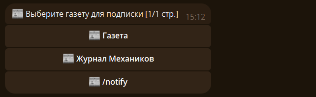
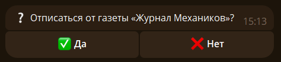
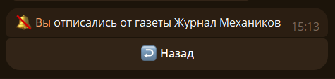
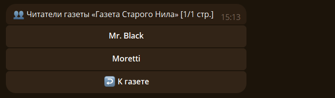

# 🗞 Читатели

В меню газет выберите `🗞 Меню читателя`, чтобы открыть список газет. Команда `/newspaper list` показывает тот же список.

## 🔔 Подписка {#subscribe}

Подпишитесь на газету кнопкой в её карточке или командой `/newspaper subscribe <id>`. Короткая команда — `/sub <id>`. Если ID не указан, бот предложит выбрать газету.

Выбираем газету

Чтобы отменить подписку, используйте кнопку `🔕 Отписаться` или команды `/newspaper unsubscribe <id>` и `/unsub <id>`. Если ID не указан, то бот предложит выбрать газету.

Подтверждаем

## 👥 Список читателей {#readers}

Откройте карточку газеты и нажмите `🗞 Читатели` либо отправьте `/newspaper readers <id>`. Выберите пользователя в списке, чтобы открыть его карточку. Редакторы с нужными правами могут назначать и снимать редакторов или передать газету.

