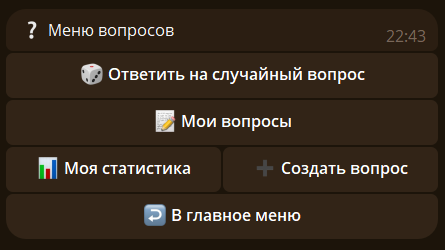
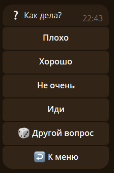
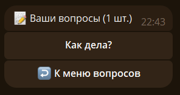
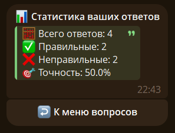
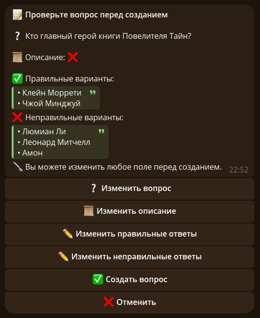
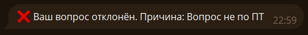

# ❔ Вопросы {#question}

Откройте раздел кнопкой `📯 Викторина` в главном меню или командой `/question`. Раздел работает в личном чате с ботом.

## 🎲 Ответить на случайный вопрос {#random}

Нажмите `🎲 Ответить на случайный вопрос` или отправьте `/question random`. Бот покажет вопрос и четыре варианта ответа. Выберите вариант, чтобы узнать, верно ли вы ответили.

После ответа можно перейти к следующему вопросу или вернуться в меню.

## 📝 Мои вопросы {#mine}

Нажмите `📝 Мои вопросы` или отправьте `/question mine`, чтобы посмотреть созданные вами вопросы. Выберите вопрос в списке, чтобы открыть его и посмотреть статистику ответов.

## 📊 Моя статистика {#stats}

Нажмите `📊 Моя статистика` или отправьте `/question stats`, чтобы посмотреть свою статистику ответов.

## ➕ Создать вопрос {#create}

Нажмите `➕ Создать вопрос` или отправьте `/question create`. Бот попросит по очереди указать текст вопроса, описание (или `-`, чтобы пропустить), правильные и неправильные варианты ответа. Для неправильных вариантов нужно указать не менее трёх.

> ❗Ответы нужно отправлять одним сообщением, каждый ответ с новой строки. Если всего ответов больше 4, то бот высветит 1 правильное и 3 неправильных, выбрав их случайно.

Перед отправкой можно проверить вопрос и изменить любое поле. После подтверждения заявка отправится на модерацию; результат придёт в личный чат с ботом.

Если вам откажут в создании, в сообщении будет указана причина.

## ⚖️ Правила создания вопросов {#rules}

- Вопрос, описание и варианты ответов не должны нарушать правила Telegram.
- Вопросы должны быть связаны со вселенной «Повелитель тайн» или её автором.
- Формулируйте вопрос понятно и без языковых ошибок.
- Используйте русский язык; допускаются иностранные имена, названия и переводы отдельных слов.
- Модератор может отказать в публикации вопроса без объяснения причин.
