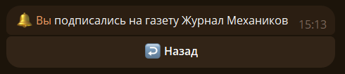
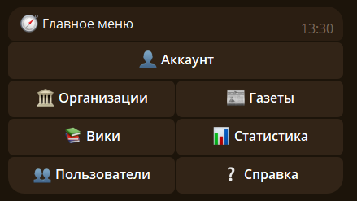
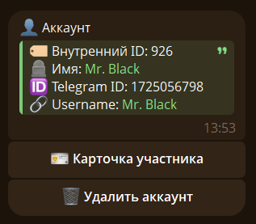
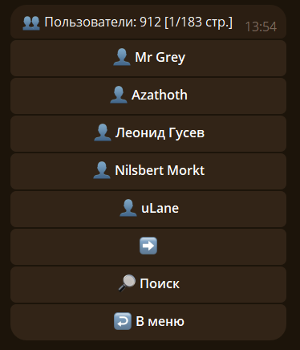
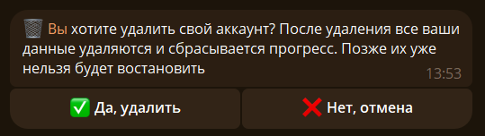
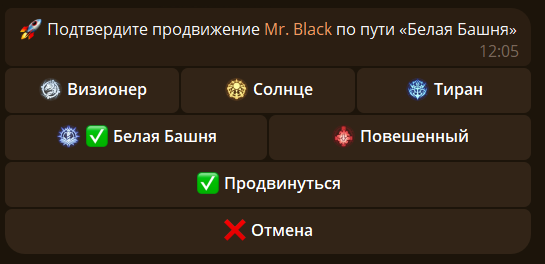

## 📰 Газеты

В меню `/newspaper` можно найти газету, посмотреть список газет и открыть её карточку. Читатели могут подписываться и отписываться, а редакторы — управлять газетой, уведомлять подписчиков и назначать редакторов.

Подробнее о создании, поиске и карточке газеты — в разделе [«Газеты»](./newspaper/main.md). Инструкции для [читателей](./newspaper/readers.md) и [редакторов](./newspaper/editors.md) помогут разобраться с подписками, настройками и выпуском новостей.

## ✨ Новые команды и возможности

- `/menu` — открыть главное меню бота.
- `/drink` — иожно выбрать путь для становления потусторонним.
- `/upseq` — можно выбрать путь для перехода.
- `/user` — посмотреть карточку аккаунта.
- `/users` — открыть список пользователей и найти пользователя по ID, username или имени.
- `/deleteuser` — запросить удаление аккаунта.
- `/beyonder` — открыть карточку потустороннего.

О командах `/user`, `/users` и `/deleteuser` читайте в разделе [«Другое»](./another/base.md), а полный список команд смотрите в [справочнике](./cmd/base.md).